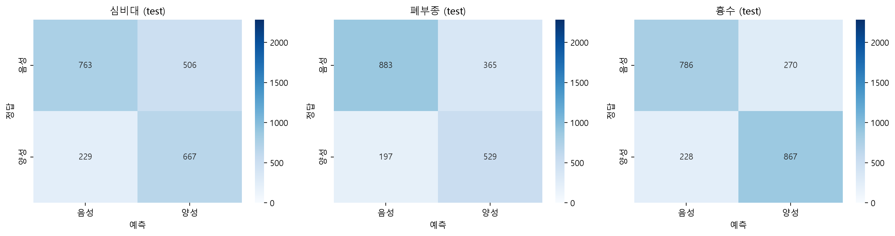
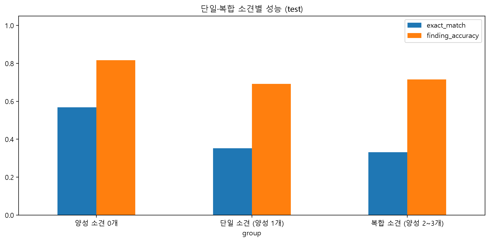

# CXR-Insight
### 흉부 X-ray 이미지 기반 심비대·폐부종·흉수 소견 탐지

흉부 X-ray 이미지를 업로드하면 **심비대·폐부종·흉수 각각의 양성 확률과 예측 결과를 제공하는 웹 애플리케이션**입니다.

소견별 Grad-CAM으로 예측에 영향을 준 영상 영역을 확인하고, 분석 결과를 PDF로 저장할 수 있습니다.

> 본 프로젝트는 교육·연구 목적으로 개발되었습니다. 예측 결과는 의료진의 진단을 대체하지 않습니다.

## 1. 프로젝트 소개

하나의 흉부 X-ray에는 여러 이상 소견이 함께 나타날 수 있습니다. 본 프로젝트는 심비대·폐부종·흉수를 동시에 예측하고, 결과를 웹 화면에서 확인할 수 있도록 구현했습니다.

모델 개발 과정에서는 모델 구조, 불확실 라벨 처리, 클래스 가중치 적용 등을 비교했습니다. 이후 소견별 성능과 단일·복합 소견의 예측 결과를 분석하고, Validation 데이터에서 추론 임계값을 검토했습니다.

## 2. 주요 기능

| 기능 | 설명 |
|---|---|
| 이미지 업로드 | 분석할 흉부 X-ray 이미지 입력 |
| 소견별 예측 | 심비대·폐부종·흉수 각각의 양성 확률과 음성·양성 예측 결과 제공 |
| Grad-CAM | 각 소견의 예측 클래스에 영향을 준 영상 영역 시각화 |
| 웹 결과 확인 | 원본 영상, 소견별 예측 결과 및 Grad-CAM 확인 |
| PDF 다운로드 | 분석 결과를 PDF로 저장 |

**사용 흐름:** 이미지 업로드 → 분석 실행 → 소견별 결과·Grad-CAM 확인 → PDF 다운로드

## 3. 설치 및 실행

### 저장소 다운로드

```bash
git clone https://github.com/Hyeryeong16/CXR-Insight.git
cd CXR-Insight
```

### 라이브러리 설치

Python 가상환경을 준비한 뒤 프로젝트의 의존성 목록에 따라 라이브러리를 설치합니다.

`requirements.txt`가 제공된 경우 다음 명령어를 사용합니다.

```bash
pip install -r requirements.txt
```

### 최종 모델 다운로드

1. [Releases 페이지](https://github.com/Hyeryeong16/CXR-Insight/releases)에 접속합니다.
2. 최종 모델 릴리스의 **Assets**에서 `best_model.pth`를 다운로드합니다.
3. 다운로드한 파일을 프로젝트의 `model/` 폴더에 넣습니다.

```text
model/best_model.pth
```

추론 코드의 체크포인트 경로도 위 위치와 일치하도록 설정합니다.

> Releases에 첨부된 모델 파일은 `git clone`이나 `git pull`로 내려받아지지 않으므로 별도로 다운로드해야 합니다.

### 웹 애플리케이션 실행

프로젝트 루트에서 Streamlit 실행 파일을 지정합니다.

```bash
streamlit run <웹_실행_파일_경로>
```

`<웹_실행_파일_경로>`를 실제 실행 파일 경로로 바꿔주세요. 실행 후 터미널에 표시되는 **Local URL**을 브라우저에서 엽니다.

## 4. 사용 방법

### ① 이미지 업로드

웹 화면의 업로드 영역에서 흉부 X-ray 이미지를 선택합니다. 화면에 안내된 지원 파일 형식을 확인하고, 업로드된 영상이 분석하려는 영상인지 확인합니다.

### ② 분석 실행

분석 실행 버튼을 누르고 결과가 표시될 때까지 기다립니다. CPU 환경에서는 분석에 더 오래 걸릴 수 있습니다.

### ③ 소견별 결과 확인

심비대·폐부종·흉수 각각의 양성 확률과 예측 결과를 확인합니다.

| 소견 | 양성 판정 기준 |
|---|---:|
| 심비대 | 양성 확률 45% 이상 |
| 폐부종 | 양성 확률 40% 이상 |
| 흉수 | 양성 확률 50% 이상 |

한 영상에서 여러 소견이 양성으로 예측될 수 있습니다.

양성 확률은 모델이 산출한 예측값이며, 실제 질환의 존재를 확정하거나 예측의 정확도를 보장하는 값은 아닙니다.

### ④ Grad-CAM 확인

소견별 Grad-CAM을 통해 **모델의 예측 클래스에 영향을 준 영역**을 확인합니다.

강조된 영역이 실제 병변 위치와 항상 일치하는 것은 아니므로, 원본 영상과 함께 참고합니다.

### ⑤ PDF 다운로드

화면의 PDF 다운로드 기능으로 분석 결과를 저장합니다.

## 5. 데이터 및 최종 모델

### 데이터셋

**MIMIC-CXR-JPG**의 이미지와 해당 데이터에 제공되는 CheXpert 라벨을 사용했습니다.

| 구분 | 이미지 수 |
|---|---:|
| Train | 9,999 |
| Validation | 1,077 |
| Test | 2,284 |
| 합계 | 13,360 |

- 세 소견이 모두 결측인 사례는 제외했습니다.
- 선정된 사례에서 나머지 결측 라벨은 음성으로 처리했습니다.
- 불확실 라벨은 U-ignore 방식으로 해당 소견의 손실 계산에서 제외했습니다.

원본 이미지와 개별 환자·검사 식별정보가 포함된 데이터는 저장소에 포함하지 않습니다. 재학습과 평가에는 승인받은 데이터가 별도로 필요합니다.

### 최종 모델

| 항목 | 내용 |
|---|---|
| 모델 구조 | DenseNet121 |
| 사전학습 | ImageNet |
| 입력 크기 | 224 × 224 |
| 불확실 라벨 처리 | U-ignore |
| 클래스 불균형 대응 | Train 분포에 따른 클래스 가중치 적용 |
| 출력 | 소견별 음성·양성 logits |
| 양성 확률 계산 | 소견별 Softmax |
| 최적 체크포인트 선정 | Validation loss 최소 |

클래스 가중치는 학습 손실에 적용하며, 추론 시 다시 적용하지 않습니다. 소견별 판정에는 Validation 분석 후 정한 **0.45 / 0.40 / 0.50**의 임계값을 사용합니다.

### 비교 실험

| 비교 항목 | 실험 내용 |
|---|---|
| 모델 구조 | DenseNet121, ResNet50 |
| 불확실 라벨 처리 | U-multiclass, U-ignore |
| 클래스 불균형 대응 | 클래스 가중치 적용 여부 |
| 학습 설정 | 입력 크기 및 학습률 스케줄러 적용 여부 |
| X-ray 사전학습 모델 | TorchXRayVision, EVA-X-S |

비교 실험의 학습 코드는 `training/`에 정리했습니다.

## 6. 성능 평가

Validation 데이터는 모델·임계값 검토에 활용하고, Test 데이터는 최종 성능 평가에 사용했습니다.

| 평가 구분 | 확인 내용 |
|---|---|
| 소견별 구별 성능 | AUROC, AUPRC/AP |
| 판정 성능 | Precision, Recall/Sensitivity, Specificity, F1 |
| 오분류 | 소견별 혼동행렬 |
| 성능의 불확실성 | Bootstrap 기반 95% 신뢰구간 |
| 단일·복합 소견 | 양성 소견 수에 따른 그룹별 성능 |

소견별 지표는 해당 소견의 불확실 정답을 제외하여 계산합니다. 그룹 분석은 세 소견 모두 확정 라벨인 영상에서 수행하며, **세 소견의 예측이 모두 맞은 비율**을 비교합니다.

### 최종 결과 파일

| 파일 | 내용 |
|---|---|
| [metrics_binary_with_ci.csv](evaluation/results/metrics_binary_with_ci.csv) | 최종 소견별 성능과 95% 신뢰구간 |
| [confusion_matrix_binary.png](evaluation/results/confusion_matrix_binary.png) | 소견별 혼동행렬 |
| [finding_groups.csv](evaluation/results/finding_groups.csv) | 그룹별 성능표 |
| [finding_groups.png](evaluation/results/finding_groups.png) | 그룹별 성능 비교 그래프 |

### 소견별 혼동행렬



### 단일·복합 소견 성능 비교



## 7. 폴더 구성

| 경로 | 내용 |
|---|---|
| `training/` | 최종 모델 및 비교 실험 학습 코드 |
| `evaluation/` | 최종 성능 평가·임계값 분석 노트북 |
| `evaluation/results/` | 최종 성능표·그래프 |
| `inference/` | 모델 로딩 및 예측 코드 |
| `gradcam/` | Grad-CAM 코드 |
| `preprocessing/` | 이미지 전처리 코드 |
| `model/` | 최종 모델 설정·학습 기록 및 체크포인트 배치 위치 |
| `notebooks/` | 데이터 분석·선정 노트북 |
| `docs/` | 프로젝트 관련 문서 |
| `data/` | 데이터 준비 관련 안내 |

### 주요 평가 파일

- `evaluation/cxr_evaluation.ipynb`: 최종 모델 성능 평가
- `evaluation/threshold_analysis.ipynb`: Validation 기반 임계값 탐색·비교

### 모델 관련 파일

- `training/` 내 `final_model.py`: 최종 모델 학습 코드
- `model/config.json`: 학습 설정과 클래스 가중치
- `model/best_val_metrics.json`: 최적 체크포인트의 Validation 성능
- `model/history.csv`: Epoch별 학습 기록
- `model/best_model.pth`: Releases에서 다운로드하여 배치하는 체크포인트

`best_val_metrics.json`은 학습 중 기본 판정 방식으로 계산한 결과입니다. 최종 임계값 적용 후의 평가 결과는 `evaluation/results/`에서 확인할 수 있습니다.

## 8. 팀 역할

| 담당 | 주요 업무 |
|---|---|
| 데이터 연결·검증 | 이미지·CSV 연결, 누락 점검, 데이터 구성 검증 |
| 모델 구현·학습 | 모델 구성, 학습 및 비교 실험 |
| 평가·결과 분석 | 성능 평가, 임계값 분석, 단일·복합 소견 비교, 오분류 분석, 추론·Grad-CAM 연동 |

모델 비교 결과를 공유하고 예측·시각화 기능을 웹 화면에 연결하는 작업을 함께 진행했습니다.

## 9. 문제 해결

| 문제 | 확인 사항 |
|---|---|
| 체크포인트를 찾을 수 없음 | `best_model.pth`의 저장 위치와 코드의 경로 확인 |
| 모듈을 불러올 수 없음 | 필요한 라이브러리 설치 여부, Python 환경 및 프로젝트 경로 확인 |
| 이미지 업로드 실패 | 지원 파일 형식과 이미지 손상 여부 확인 |
| 분석이 느림 | 실행 장치 확인. CPU 환경에서는 처리 시간이 증가할 수 있음 |
| 웹 화면에 접속할 수 없음 | 앱 실행 상태와 터미널에 표시된 Local URL 확인 |

## 10. 한계 및 사용 시 유의사항

- 예측 대상은 심비대·폐부종·흉수 세 가지이며, 다른 이상 소견은 평가하지 않습니다.
- 음성 예측이 이상 소견의 부재를 보장하지 않습니다.
- 영상 품질과 촬영 조건, 학습 데이터와의 차이에 따라 성능이 달라질 수 있습니다.
- 판독문 기반 라벨과 결측 라벨 처리 방식이 학습·평가에 영향을 줄 수 있습니다.
- Grad-CAM은 병변 위치를 확정하는 도구가 아닙니다.
- 임상 활용을 위해서는 추가 검증과 사용자 평가가 필요합니다.

## 11. 기술 스택

Python · PyTorch · torchvision · NumPy · pandas · scikit-learn · Matplotlib · Seaborn · Streamlit · Git/GitHub

## 12. 참고 자료

- [MIMIC-CXR-JPG](https://physionet.org/content/mimic-cxr-jpg/)
- [TorchXRayVision](https://github.com/mlmed/torchxrayvision)
- [EVA-X](https://github.com/AcademyCityL/EVA-X)
